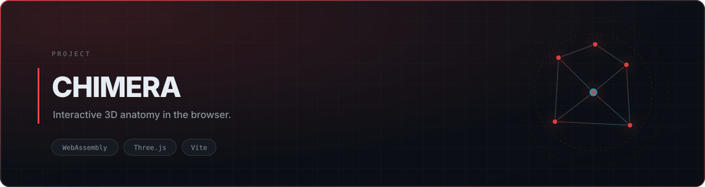

<div align="center">

<picture>
  <source media="(prefers-color-scheme: dark)" srcset="./assets/banner-dark.svg">
  <source media="(prefers-color-scheme: light)" srcset="./assets/banner-light.svg">
  
</picture>

<br>


<br><br>

<a href="#quick-start">Quick Start</a> · <a href="#features">Features</a>

</div>

## Overview

Anatomy is spatial, but most study material is flat. **CHIMERA** renders an interactive 3D anatomical model in the browser with pronunciation support, so structure and name are learned together instead of separately.

> **Scope note:** this repository contains the **compiled production build**, not the original source. It is kept as a live demonstration artifact and is not set up for modification.

## Features

| | |
|---|---|
| **3D anatomy viewer** | Rotatable model with labeled structures |
| **Pronunciation** | Dictionary-backed audio for anatomical terms |
| **WebAssembly core** | Heavy geometry work compiled to wasm for browser performance |
| **Zero build step** | Ships as static output — clone and serve |

## Stack

WebAssembly · Three.js · Vite build output · CMU pronouncing dictionary

## Quick Start

```bash
git clone https://github.com/tribetorkoz/chimera-anatomy.git
cd chimera-anatomy
npx serve .        # or open index.html via any static host
```


## License

MIT
